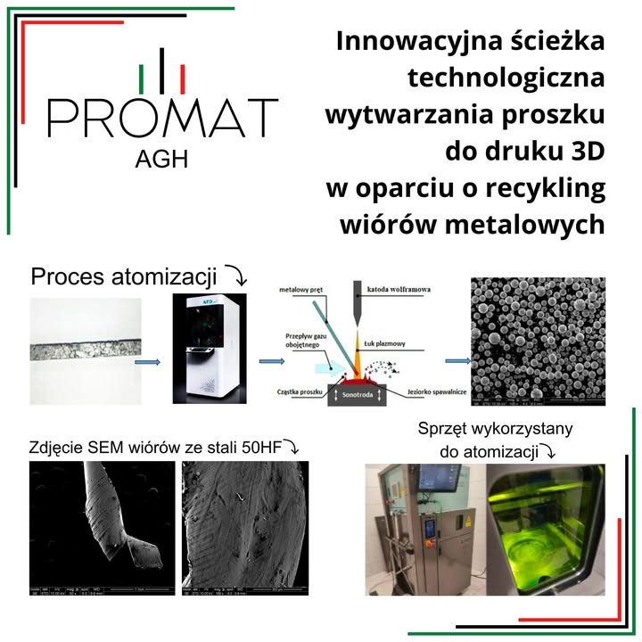

💥Atomizacja wiórów💥
W ramach drugiego projektu, który pomyślnie zakończyliśmy w ramach Grantu Rektora na rok 2024, opracowaliśmy proces przekształcania odpadów z obróbki metali w wysokiej jakości proszek do zastosowań w druku 3D. Dzięki tej technologii wióry metalowe zyskują nowe życie.

🔬 Proces recyklingu:
1️⃣ Przygotowanie materiału – Wióry metalowe są oczyszczane i zagęszczane w celu usunięcia zanieczyszczeń.
2️⃣ Atomizacja – Materiał zostaje przekształcony w sferyczne cząstki metalu o odpowiednich właściwościach do zastosowania w technologii druku 3D.
3️⃣ Produkcja – Uzyskany proszek metalowy wykorzystuje się do wytwarzania wytrzymałych i precyzyjnych komponentów.

To rozwiązanie pozwala na zmniejszenie ilości odpadów przemysłowych, ograniczenie zużycia surowców oraz obniżenie kosztów produkcji. Projekt łączy zaawansowane technologie z ideą zrównoważonego rozwoju, przyczyniając się do ochrony środowiska.