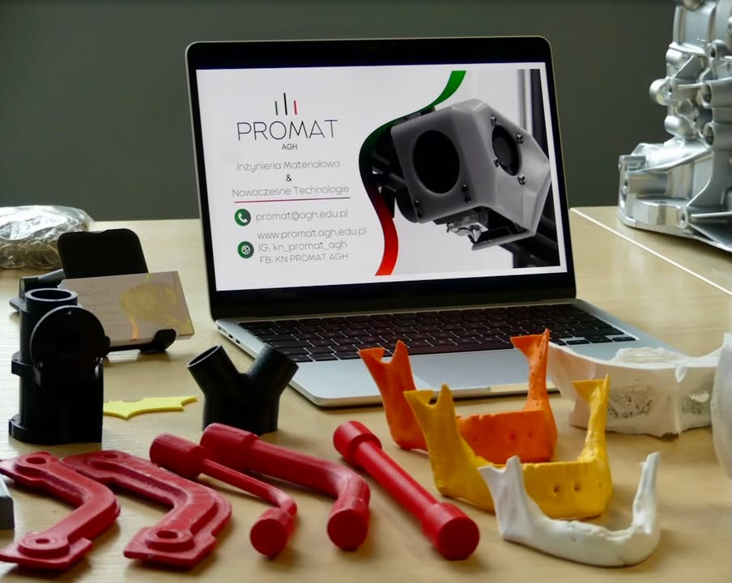

📣 W piątek 28 marca mieliśmy ogromną przyjemność zaprezentować się jako KN PROMAT podczas III Ogólnopolskiego Dnia Inżynierii Materiałowej na AGH! 🔧🧠

Na naszym stanowisku można było zobaczyć druk 3D w akcji — na żywo drukowaliśmy różne małe modele, pokazując jak wygląda cały proces. Przygotowaliśmy też sporo ciekawych wydruków, które wzbudzały zainteresowanie odwiedzających – od elementów anatomicznych przez fragmenty protptypów z naszych projektów, aż do większych wydruków takich jak model Sukiennic.
👩‍🔬🧑‍🔬 Nasz zespół z zaangażowaniem opowiadał o technologii druku 3D, materiałach, które wykorzystujemy i o tym, jak wygląda praca w naszym kole.

Dziękujemy wszystkim, którzy nas odwiedzili – było super spotkać się z Wami i podzielić naszą pasją do inżynierii materiałowej! 💡🔥
Do zobaczenia na kolejnych wydarzeniach! 💬

#KNPromat #AGH #ODIM2025 #druk3D #inżynieriamateriałowa #PROMAT #AGH #studentlife