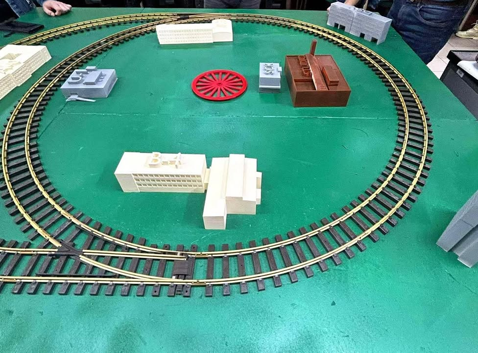

Uwaga, uwaga! Budujemy AGH!   🏗️🚂

Co słychać w naszej Promatowej pracowni? Ano, dzieje się! Nasz projekt z Grantu Rektora 2025 - stanowisko szkoleniowe do nauki programowania  robota przemysłowego - nabiera kształtów, mianowicie kampusu AGH 💚🖤❤️.  
Budynki naszego Wydziału już wyszły z drukarek 3D, a my czujemy się jak mali bogowie architektury 🫡.  Jest cięcie, klejenie, malowanie i dużo kawy ! Jak wyglądały ostatnie prace nad naszym projektem możecie zobaczyć na fotkach ! 📸
Który budynek rozpoznajecie?  

Co dalej? Teraz przed nami faza "artystyczna" - detale i dopracowanie, aby nasza kolejka jeździła bez zarzutu! 💯🔋
Następnie faza integracji makiety szkoleniowej ze stanowiskiem wyposażonym w ramie robotyczne 🦾.