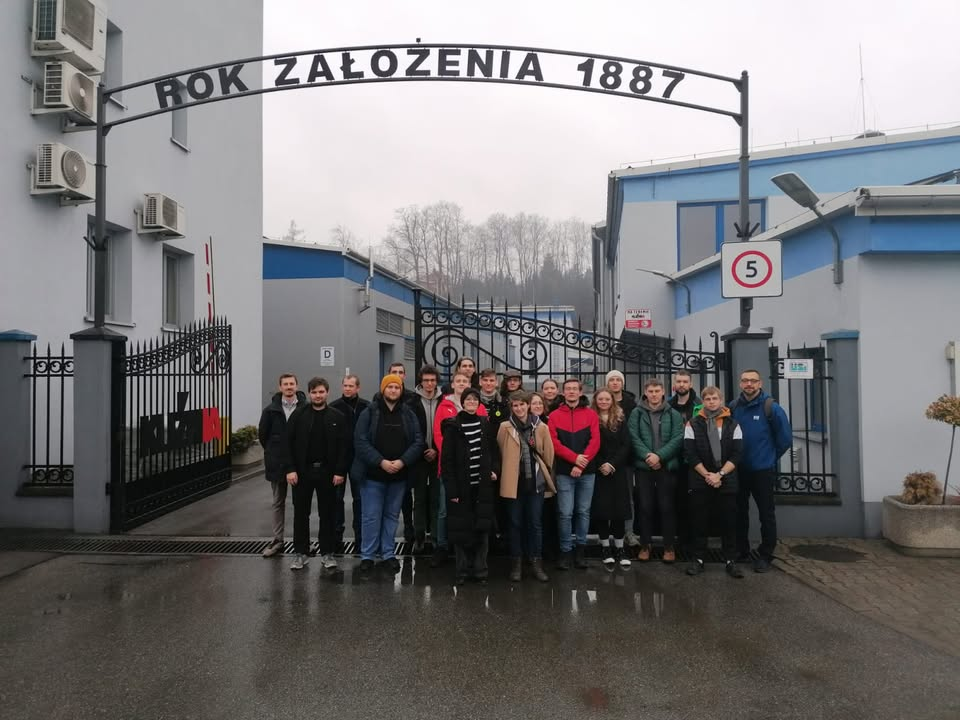

Odwiedziliśmy dziś Kuźnię Sułkowice S.A. wraz z Kołem Naukowym Hefajstos! 🛠️

Mieliśmy możliwość zobaczenia kompletnego procesu technologicznego wytwarzania odkuwek matrycowych – od przygotowania matryc, kucia na gorąco, obróbkę cieplną, obróbkę skrawającą, aż  po badania wytrzymałościowe wykonywane na gotowych wyrobach. Mogliśmy oglądać na żywo jak wygląda cały proces produkcyjny części i komponentów dla różnych gałęzi przemysłu. ⚙️👩‍🔧👨‍🔧

Dziękujemy Kuźni Sułkowice S.A. za możliwość zobaczenia jak wiedza ze studiów jest wykorzystywana w praktyce! ⚡️