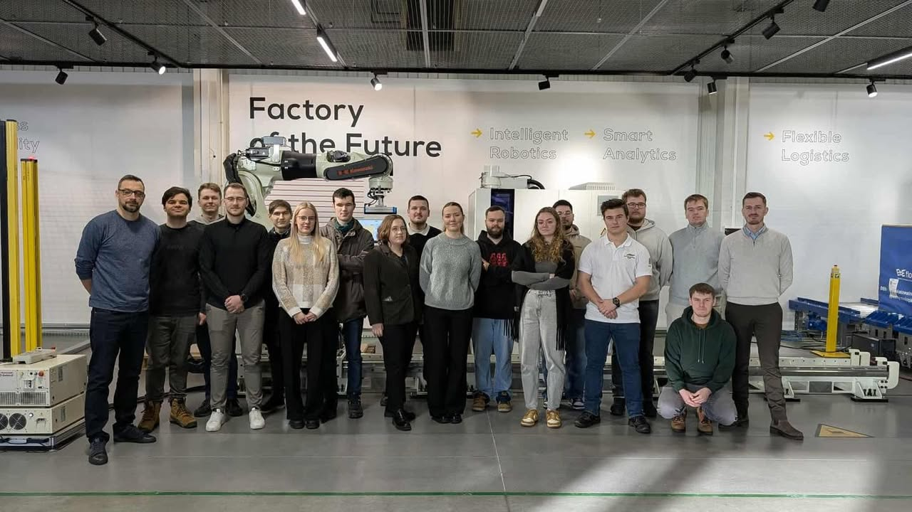

Za nami wyjazd do ASTOR!

Podczas wizyty mieliśmy okazję bliżej poznać nowoczesne rozwiązania stosowane w robotyzacji i automatyzacji procesów przemysłowych⚙️. 
Zobaczyliśmy z bliska różne typy ramion robotycznych oraz mogliśmy na żywo zaobserwować ich sposób pracy i precyzję działania🦾. Szczególnie interesujące było poznanie praktycznych przykładów zastosowania robotów, systemów wizyjnych oraz nowoczesnych rozwiązań sterowania 🕹️. Wraz z nami w warsztatach również brali udział studenci z AGH Hefajstos oraz SKN Creative AGH . 

Serdecznie dziękujemy firmie ASTOR za możliwość zobaczenia w praktyce, jak nowoczesne technologie kształtują współczesny przemysł! 🚀