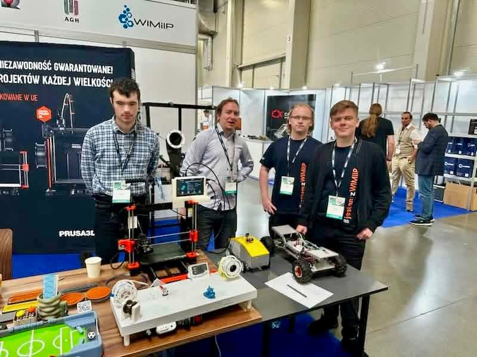

W dniu 7-8 października 2026 r. mieliśmy przyjemność uczestniczyć w targach KOMPOZYT-EXPO jako część stoiska naszego Wydziału! 🎓

Podczas wydarzenia zaprezentowaliśmy projekt, nad którym pracujemy - recykling butelek PET i ich przetwarzanie na filament wykorzystywany w druku 3D. ♻️➡️🧵➡️🖨️

Targi KOMPOZYT-EXPO były świetną okazją do pokazania efektów naszej pracy, rozmów z przedstawicielami branży oraz wymiany doświadczeń z innymi osobami zainteresowanymi nowoczesnymi materiałami, recyklingiem i technologiami wytwarzania.

Dziękujemy za wszystkie rozmowy, pytania i zainteresowanie naszym projektem! 💚

#KOMPOZYTEXPO2026 #Recykling #PET #Filament #Druk3D #3DPrinting ##Innowacje #KołoNaukowe