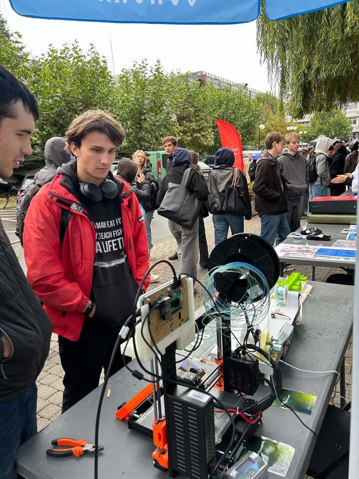

14 października mieliśmy przyjemność uczestniczyć w Targach Organizacji Studenckich AGH, gdzie mogliśmy opowiedzieć Wam więcej o działalności naszego Koła Naukowego PROMAT. I musimy przyznać - frekwencja i zainteresowanie nas pozytywnie zaskoczyły! 🔥

Dziękujemy wszystkim, którzy odwiedzili nasze stanowisko, porozmawiali z nami i chcieli dowiedzieć się, co robimy. Cieszymy się, że mogliśmy poznać tyle nowych osób i podzielić się z Wami naszą pasją! 🙌🏻

Jeżeli nie zdążyliście z nami porozmawiać albo po wczorajszym dniu czujecie, że chcielibyście działać z nami, a w tym zdobywać praktyczne doświadczenie i tworzyć super projekty - możecie dołączyć już dziś! 🤝

📩 Napisz do nas na Facebooku lub Instagramie!

📷: https://www.instagram.com/kn_promat_agh?exln=MXd1aGtqaG90cjFtMQ%3D%3D&utm_source=qr