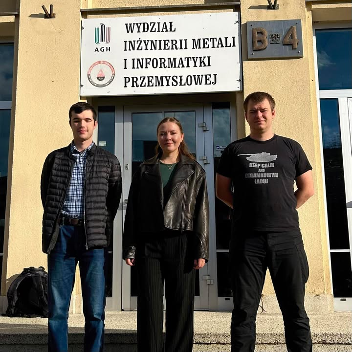

Z dumą i wielką ekscytacją przedstawiamy Nowy Zarząd Koła Naukowego Promat na kadencję 2026/2027! 🚀

Oto osoby, które w najbliższym roku przejmą stery, będą dbać o nasze projekty, dowozić nowe inicjatywy i reprezentować naszą społeczność:

▪️ Przewodniczący: Maciej Szeptuch
▪️ Zastępca Przewodniczącego: Anna Maliszewska
▪️ Sekretarz: Wiktor Chowaniec

Przed nami rok pełen wyzwań, nowych projektów, konferencji i wydarzeń. Bądźcie czujni – pierwsze efekty naszej pracy już wkrótce! 🔥💪

Zapraszamy również do dołączenia do naszej społeczności i towarzyszenia z nami w przyszłych działaniach koła, napisz do nas na promat@agh.edu.pl ⚡