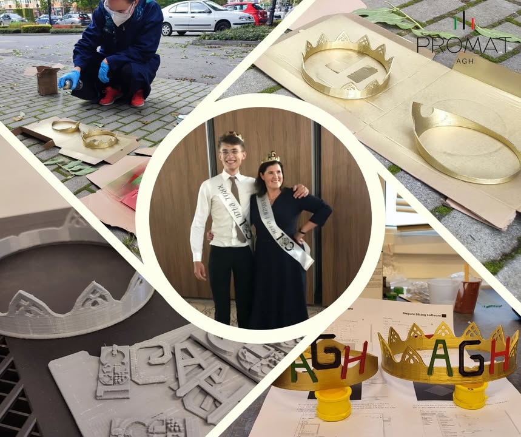

W poprzedni piątek na naszym Wydziale odbył się Bal Hutnika 2022 💃🕺, na którym świętowaliśmy wspólnie obchody 💯lecia Wydział Inżynierii Metali i Informatyki Przemysłowej. Członkowie naszego koła 👩‍💻 oprócz uczestnictwa w balu przyczynili się również do uświetnienia tego wydarzenia🎉. Sekcja druku 3D KN Promat dzielnie pracowała w okresie wakacyjnym🌤, aby własnoręcznie zaprojektować i wydrukować korony👑, które następnie otrzymali wyłonieni w głosowaniu📥 Królowa i Król Balu Hutnika 2022. Królową👸 została Pani Dziekan prof. dr hab. inż. Agnieszka Kopia, a Królem🤴 student Inżynierii Obliczeniowej Hubert Kotliński. Mamy nadzieję, że bawiliście się równie dobrze jak my❗️

#agh #wimiip #100latwimiip #promatagh #jestemzWIMiIP