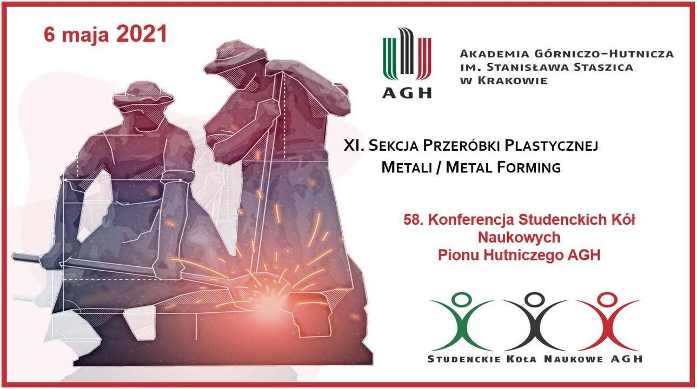

🟢⚫️🔴58. Konferencja Studenckich Kół Naukowych Pionu Hutniczego AGH dobiega końca. Wysłuchaliśmy wielu ciekawych prezentacji oraz mieliśmy okazję uczestniczyć w pasjonujących dyskusjach 🤓
A my przy okazji chcielibyśmy się pochwalić sukcesem studentki z naszego Koła Naukowego ❕ Wiktoria Skonieczna otrzymała wyróżnienie na Sekcji Przeróbki Plastycznej za referat pod tytułem: "Wpływ temperatury podczas odkształcenia z małymi prędkościami na zmiany mikrostruktury stopu Ti-5Al-5Mo-5V-3Cr otrzymanego metodą metalurgii proszków" 
Serdecznie gratulujemy! 🥳

#agh #promatagh #dzienhutnika