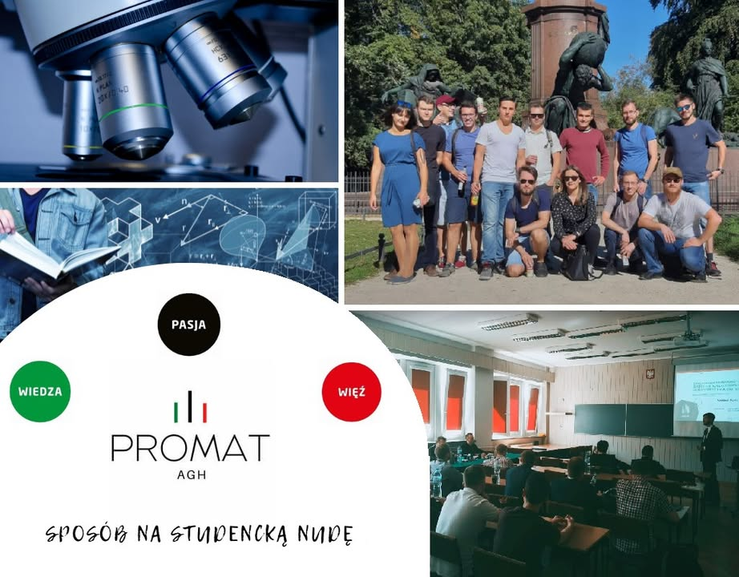

Koła naukowe? A po co to komu... 
Spieszymy z odpowiedzią!☝☝

👉 Czy wiesz, że w Polsce jest ponad 2 tysiące kół naukowych⁉️ W tym blisko 140 tylko na naszej Uczelni‼🤯

👉 Koła naukowe na AGH łączą osoby o podobnych zainteresowaniach, które chcą rozwijać swoje pasje, zdobywać nowe doświadczenie, a także dzielić się tym już zdobytym. Realizują przy tym hasło przewodnie naszej uczelni – „Wiedza – Pasja – Więź” 🟢⚫️🔴

👉 Oprócz ciągłego poszerzania horyzontów, członkowie kół na AGH biorą udział w wielu wydarzeniach, takich jak Sesja Kół👨‍💼, Dni Otwarte🗓, Małopolska Noc Naukowców🧑‍🔬 czy Festiwal Nauki💫, podczas których dzielą się swoimi osiągnięciami. Dobro innych nie jest obce naszym studentom, dlatego akcje charytatywne również są organizowane, przykładem jest tu akcja „Święta Dzieciom”.🧸

👉 Nie samą pracą żyje człowiek - koła oferują swoim członkom wspaniałe wyjazdy🚌 - nie tylko do firm z branży, ale również wyjazdy integracyjne pozwalające poznać siebie nawzajem. 😎

👉 Praca w kołach naukowych to pierwsze kroki do przyszłej kariery zawodowej. Dzięki działaniu w kołach zdobędziesz takie kompetencje jak: pracowitość, kreatywność, umiejętność pracy pod presją czasu i stresu, umiejętność pracy w grupie czy samodzielność. Zdobytym doświadczeniem będziesz mógł pochwalić się w CV 📑 i sprawić, że przyszły pracodawca wybierze właśnie Ciebie. 💪

👉 Nie zwlekaj i dołącz do Nas już dziś - Koło Naukowe PROMAT czeka właśnie na takich jak TY 😎

#agh #wiedza #pasja #więź #wimiip #promatagh #jestemzWIMiIP