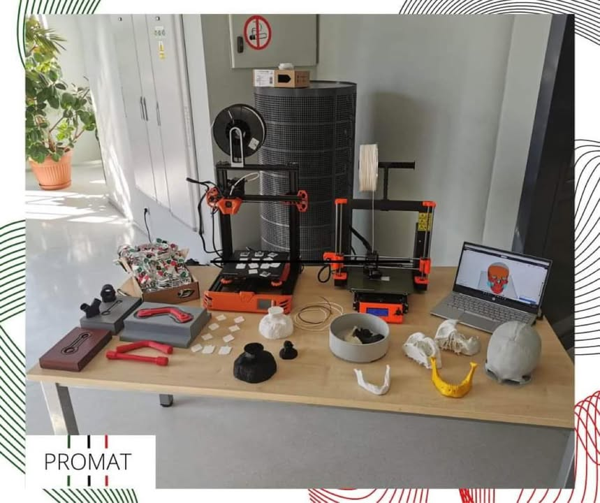

Co to był za dzień! 💚🖤❤️No bo co jest bardziej interesujące dla koła pełnego materiałoznawców, niż Dzień Inżynierii Materiałowej!!
Na naszym stanowisku mogliście zaobserwować szerokie zastosowanie druku 3D- który jest tematem wiodącym naszego tegorocznego projektu Grantu Rektora! Koleżanki pokazywały przykładowe modele, projekty wykonywane w specjalnych programach komputerowych oraz same maszyny! Nie zabrakło również małych upominków dla was- mogliście zabrać ze sobą wydrukowany przez nas QR kod, który zaprowadzi was prosto na stronę naszego wydziału! Myśle ze udowodniliśmy wam, że przy druku 3D- to jedyne co was ogranicza to wasza kreatywność!
Cieszymy się ogromnie z tak licznego zainteresowania! Miło było się z wami zobaczyć!! Mamy nadzieje, że za niedługo powtórka na spotkaniu naszego Koła Naukowego!
Koniecznie zapiszcie sobie tę datę w kalendarzu na następny rok 🗓️, ponieważ jak sami widzicie- nie możecie tego ominąć!!

#jestemzWIMiIP