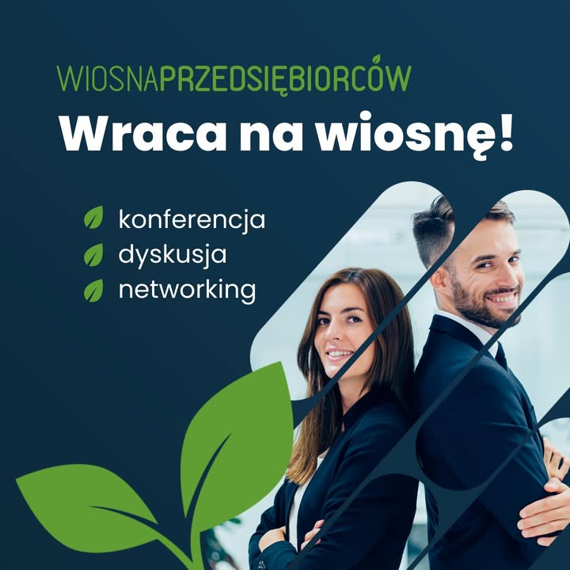

Chcielibyśmy powiadomić was o wspaniałej konferencji, która odbędzie się już za niedługo ⏰

🍀Zapraszamy wszystkich na XI edycję Wiosny Przedsiębiorców! 🍀

📅KIEDY: 25 marca  
📍GDZIE: AGH, budynek D-14, sala A0.3

W tym roku hasło przewodnie to: SAMOROZWÓJ JEST KLUCZEM DO SUKCESU. ✨

Podczas konferencji będziecie mieli możliwość zdobycia niezbędnych informacji na temat prowadzenia własnego biznesu, a także uzyskania wiedzy na wiele innych zagadnień, które mają pomóc młodym ludziom stawiać pierwsze kroki w kierunku przedsiębiorczości. Wspólnie z wykwalifikowaną kadrą prelegentów oraz przedsiębiorcami z Krakowa chcemy pokazać, jak ważny obecnie jest samorozwój, a także jak łatwo założyć własny biznes.  

Więcej informacji pod linkiem do wydarzenia: https://fb.me/e/2I1zoRFEQ 
 
Gorąco zachęcamy zainteresowanych do zgłoszenia swojej obecności we formularzu: https://forms.office.com/e/j8aJB0t4DW

Zgłoszenia można wysyłać do 24.03.2023, do godziny 18🥰 
Gorąco zapraszamy!!❤️

#jestemzWIMiIP