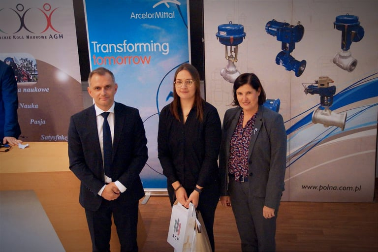

Mamy to✨

W zeszły poniedziałek, finał konkursu „Ubierz swoją pracę w poster!” okazał się szczęśliwy dla jednej z naszych koleżanek 😊

Poster pt. "Wpływ temperatury podczas odkształcania z małymi prędkościami na zmiany mikrostruktury stopu Ti-5Al-5Mo-5V-3Cr otrzymanego metodą metalurgii proszków" zaprojektowany przez Wiktorię Skonieczną zajął trzecie miejsce na podium 🥉

Serdecznie gratulujemy wszystkim uczestnikom i trzymamy kciuki za dalsze sukcesy ✊

#AGH #KNPromat #wimiip #KPPM #jestemzWIMiIP