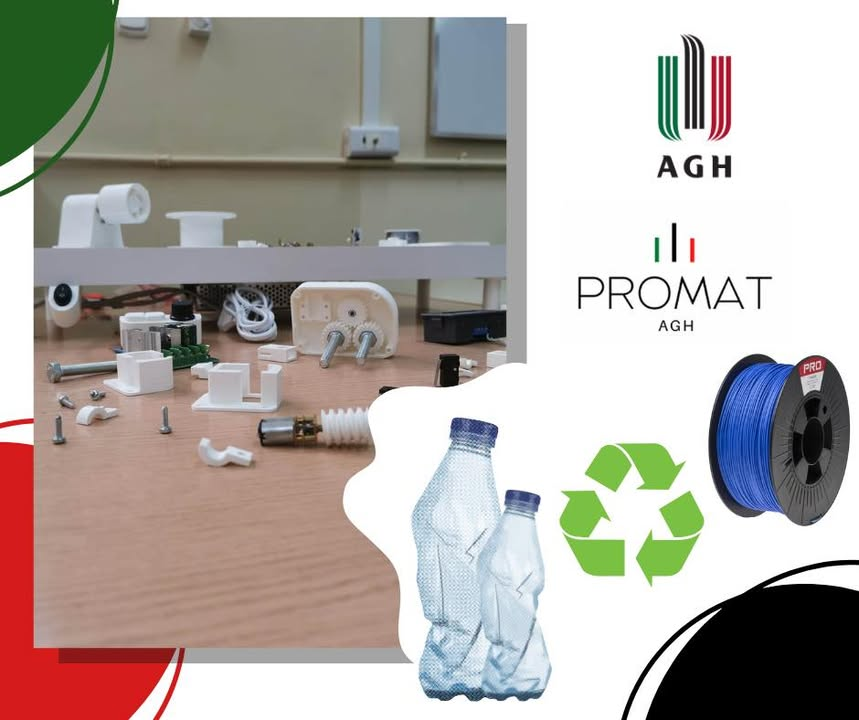

Jak ten czas szybko mija! Kolejny rok akademicki praktycznie za nami.📆
Nasze koło nie przespało tego czasu - prężnie realizowany był projekt Grant Rektora 2023 „Konstrukcja urządzenia przetwarzającego tworzywo PET uzyskane z recyklingu butelek na filament do druku 3D”♻️📚. Za nami już planowanie całego projektu, drukowanie części oraz złożenie urządzenia👩🏻‍🔧👨🏻‍🔧. Przed nami teraz najlepsza część - testy! 👨🏻‍🔬👩🏻‍🔬Wszyscy zastanawiamy się jakie wyniki osiągniemy i czy nasz projekt będzie odpowiedzią na nurtujący nas problem recyklingu plastikowych butelek?🤔
Na pewno wrócimy do Was z updatem!💚🖤❤️

#jestemzWIMIiP