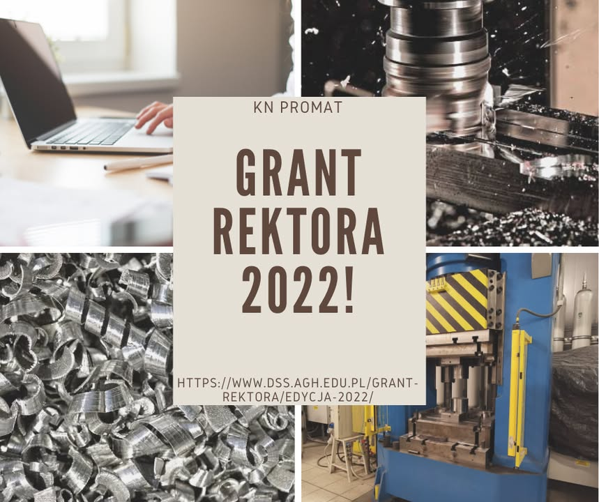

Cześć!
W ten weekend świętowaliśmy !🥳
Wszystko dlatego, że otrzymaliśmy Grant Rektora! 💪
✅Będziemy realizować projekt pt. "Recykling wirów metalowych poprzez zagęszczanie i przeróbkę plastyczną". 
✅ Celem projektu będzie opracowanie technologii recyklingu wirów metalowych powstałych podczas obróbki ubytkowej poprzez ich zagęszczanie, a następnie przeróbkę plastyczną.

O wynikach naszej pracy będziemy informować na bieżąco 🧐

Zachęcamy do zapoznania się z wynikami konkursu "Grant Rektora 2022":
https://www.dss.agh.edu.pl/grant-rektora/edycja-2022/

#jestemzWIMiIP