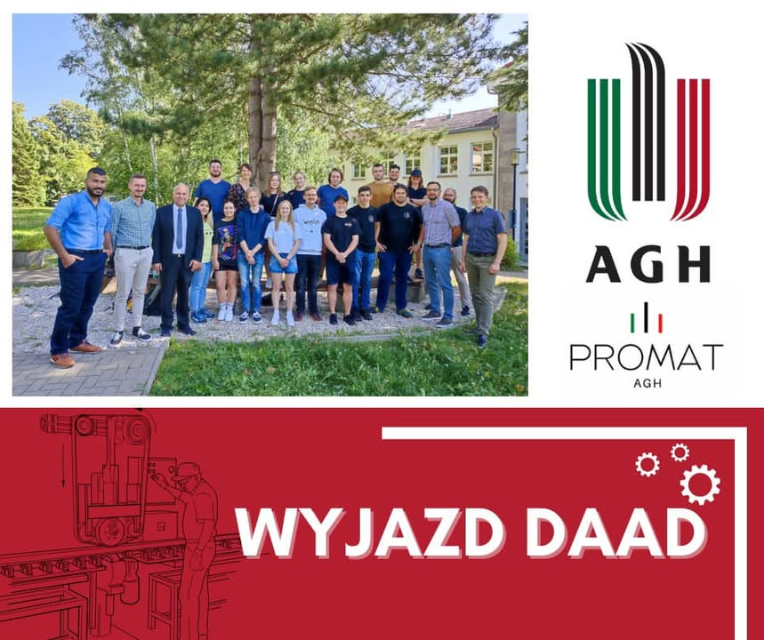

Pewnie każdy z Was zastanawia się jak połączyć przyjemne z pożytecznym🤔? Otóż Koło Naukowe Promat spieszy z odpowiedzią! Razem z kolegami z KN Hefajstos oraz KN MSS znaleźliśmy złoty środek! 🏆🎉
We wrześniu braliśmy udział w wyjeździe w ramach stypendium Deutscher Akademischer Austausch Dienst🧑🏻‍🎓👨🏻‍🎓! 
Celem podróży były trzy niemieckie Uniwersytety 🧑‍🏫📚oraz trzy zakłady produkcyjne🏭. Podczas wyjazdu studenci mieli zaplanowany bogaty program aktywności, które obejmowały zwiedzanie, pokazy oraz wspólne warsztaty, sympozja i integracje ze studentami z niemieckich uczelni🎉🔬🧫🧪📚.
Mieliśmy okazję przyjrzeć się z bliska różnym unikatowym prototypom, poznać sposobu funkcjonowania urządzeń badawczych i linii przemysłowych, których nie można zobaczyć w Polsce.
Nie zabrakło też czasu na zwiedzanie starego miasta w Dreźnie! Studenci mieli okazję zobaczyć między innymi Pałac Zwinger, Altmarkt, Frauenkirche, Fürstenzug, Goldener Reiter oraz Neustadt🗺️🧭.
Były to naprawdę ciekawe i intensywne dwa tygodnie dla Naszych studentów! 
Jeżeli też chciałbyś wzbogacić swoje doświadczenie o takie przeżycia- zapraszamy do dołączenia do KN Promat! 🧪🎉

Chętnych zapraszamy do napisania na promat@agh.edu.pl 👩🏻‍🔬👨🏻‍🔬

#jestemzWIMiIP