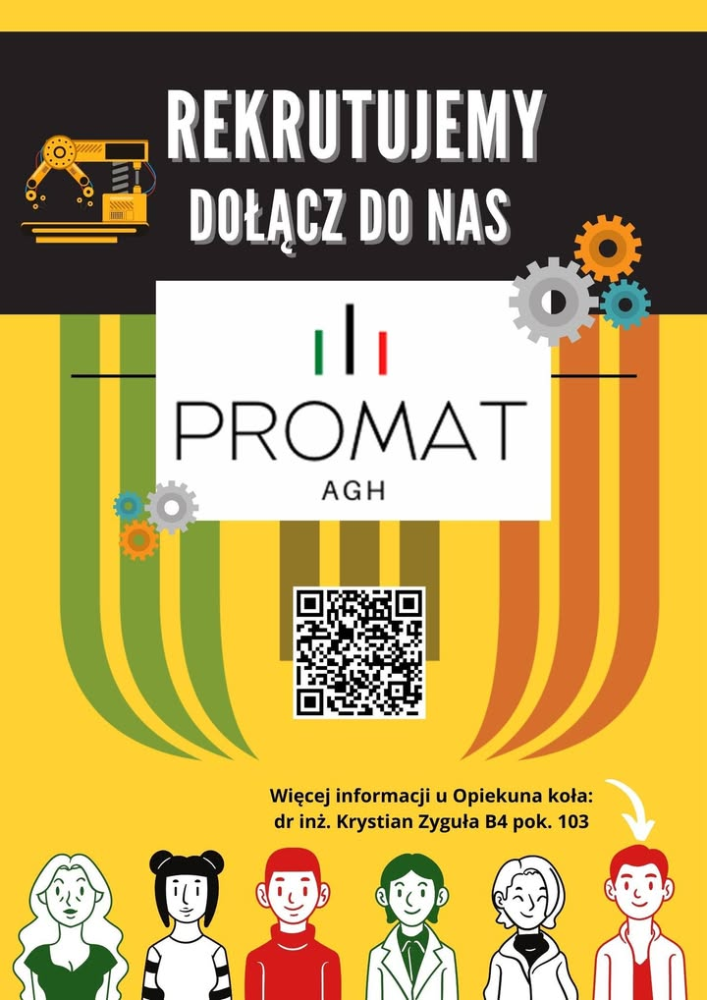

🔬🖨️ Szukamy pasjonatów materiałoznawstwa i druku 3D! 🌟

Cześć! Jesteśmy Kołem Naukowym PROMAT. Jeśli jesteś zainteresowany tym fascynującym obszarem nauki i chciałbyś do nas dołączyć, to świetnie trafiłeś!

🌐 O nas:
Nasz zespół pasjonatów zgłębia tajniki materiałoznawstwa, tworzenia nowych materiałów oraz zaawansowanego druku 3D. Realizujemy projekty badawcze, eksperymenty, i rozwijamy się w dynamicznym środowisku.

🤝 Dlaczego warto do nas dołączyć?
Dołączając do naszego koła:

Rozwiniesz swoje umiejętności praktyczne w dziedzinie materiałoznawstwa i druku 3D.
Poznasz inspirujących ludzi, którzy podzielają Twoją pasję.
Zdobędziesz wiedzę, która może Ci się przydać w przyszłej karierze naukowej lub zawodowej.

Jeśli jesteś zainteresowany, napisz do nas na promat@agh.edu.pl. Czekamy na Ciebie!

Do zobaczenia w naszym zespole! 🔬🖨️💡

#jestemzWIMiIP