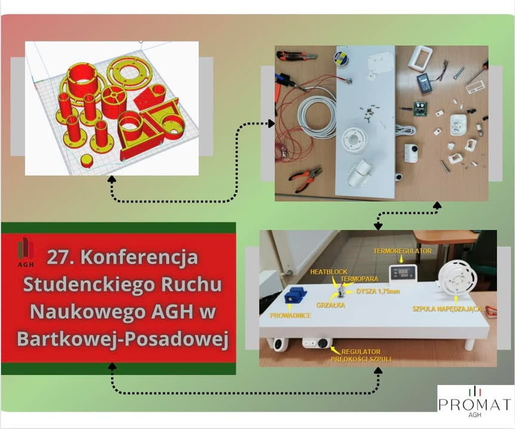

Kolejny rok akademicki rozpoczął się pełną parą! 📚👨🏻‍🔬👩🏻‍🔬
A to oznacza tylko jedno – podsumowanie projektów nad którymi pracowaliśmy przez minione semestry! Projekt Grant Rektora 2023 zwieńczyliśmy wystąpieniem na 27. Konferencji Studenckiego Ruchu Naukowego AGH w Bartkowej-Posadowej!🎉👨🏻‍🏫👩🏻‍🏫

Przedstawiliśmy konstrukcję urządzenia przetwarzającego tworzywo PET uzyskane z recyklingu butelek na filament do druku 3D♻️

Jak zapewne wiecie, plastikowa butelka to jeden z najbardziej problematycznych odpadów na świecie. Nasz projekt ma na celu zmniejszenie ilości tych butelek poprzez przetwarzanie ich na filament do drukarek 3D.

Chociaż to naprawdę długi rok ciężkiej pracy, czujemy, że jesteśmy na właściwej drodze📈. Nasze ambicje sięgają daleko poza samą budowę urządzenia. Chcemy rozwinąć nasz projekt do takiego stopnia, aby pracować wyłączne na filamencie naszej produkcji! 🏭

‼️Bardzo chcielibyśmy abyście byli częścią tego! Dlatego ogłaszamy rozpoczęcie cyklu na temat druku 3D – posty będą pojawiać się co dwa tygodnie w czwartki! Znajdziecie tam wiele informacji na temat naszych postępów, jak i również możecie spodziewać się rozwinięcia wielu nurtujących problemów, które pojawiają się przy rozpoczynaniu swojej przygody z drukiem 3D! ‼️

#jestemzWIMiIP