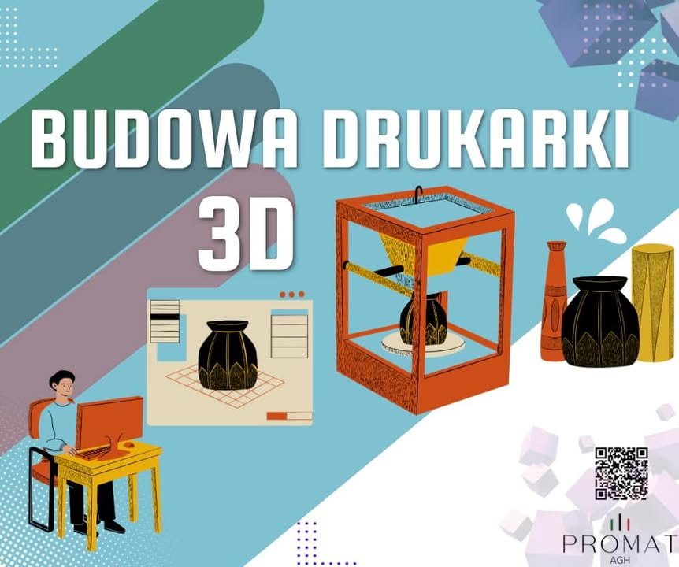

Każdy z nas choć raz w życiu miał sytuację kiedy potrzebował jakiejś części, która już wyszła z produkcji, lub wymarzyła nam się jakaś dekoracja, której zamówienie było niemożliwe...
Na takie dylematy odpowiedz jest prosta! Wystarczy zbudować własną drukarkę 3D i wtedy naszym jedynym ograniczeniem będzie kreatywność!
 
Oto przepis na zbudowanie własnej drukarki 3D:
 
1. Ramka: Najlepiej wybrać wytrzymałą strukturę, taką jak aluminium lub stal, która zapewni stabilność i precyzję.
 
2. Silnik krokowy: Drukarka 3D wymaga silników krokowych, które będą odpowiedzialne za ruch osi X, Y i Z.
 
3. Sterownik silnika: Tutaj potrzebujemy sterownika silnika krokowego, który będzie kontrolował ruch tych osi. Najczęściej używane są sterowniki druku RAMPS lub TMC2130.
 
4. Ekstruder: Ekstruder to część drukarki odpowiedzialna za podawanie filamentu do drukowania.
 
5. Zestaw gorących końcówek: Tu potrzebujemy elementu, który rozpuszcza filament i odkłada go na podstawie. Możemy wybrać zestaw ze stalowymi lub mosiężnymi dyszami o różnych średnicach.
 
6. Zasilacz: Drukarka 3D potrzebuje zasilacza o odpowiednim napięciu i mocy, aby dostarczyć prąd do wszystkich komponentów.
 
7. Płyta główna: Wybór płyty głównej będzie zależał od preferencji i potrzeb. Najpopularniejsze to Arduino Mega, RAMPS lub Duet WiFi.
 
8. Wentylatory: Drukowanie 3D wytwarza dużą ilość ciepła, dlatego ważne jest zainstalowanie wentylatorów, aby schłodzić podstawę, gorące końcówki i elektronikę.
 
9. Przenośniki pasów: Potrzebujemy przenośników pasów, aby kontrolować ruch osi X i Y. Mogą one być wykonane z nylonu lub tworzyw sztucznych.
 
10. Inne elementy: Przewody, łożyska, śruby, wkręty, podkładki - niezbędne do połączenia wszystkich części razem.
 
Oczywiście ta lista jest ogólna i może się różnić w zależności od projektu drukarki 3D, który zamierzacie zbudować. Pamiętajcie również, że przy budowie drukarki 3D ważne jest korzystanie z odpowiednich narzędzi i przeczytanie instrukcji dostarczanych wraz z zakupionymi częściami.
 
Poza tymi elementami, do drukowania niezbędny jest również projekt oraz filament... Czekajcie na następne posty, bo w nich na pewno znajdziecie odpowiedzi na inne nurtujące Was pytania!

#jestemzWIMiIP