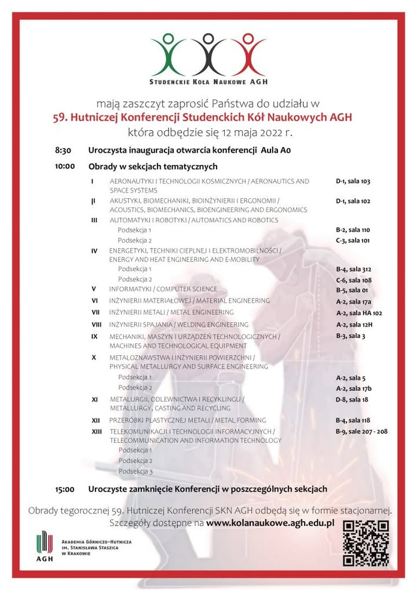

Cześć !🙌
59. Hutnicza Konferencja Studenckich Kół Naukowych AGH już w ten czwartek! 
Nie wiem jak Wy, ale my już nie możemy się doczekać! 🤩
Koło Naukowe PROMAT będzie miało oczywiście silną reprezentacje 😎 Swoje referaty zaprezentują:
1. Natalia Ozdoba - "Badanie Wpływu Czasu Spiekania w Procesie SPS Na Wybrane Właściwości Kompozytów ALUMIX431-B4C"
2. Mateusz Michalak - "Ocena Stopnia Zniszczenia Eksploatacyjnego Materiałów Pracujących w Energetyce"
3. Nikodem Sroczyk - "Recykling Wirów Metalowych Poprzez Zagęszczanie i Przeróbkę Plastyczną"
4. Wiktoria Skonieczna - "Wpływ Metody Wytwarzania na Wybrane Własności Stopu Tytanu z Grupy 𝜷"

Widzimy się na obradach!🤓
#promat #agh #dzienhutnika #100latWIMiIP #jestemzWIMiIP