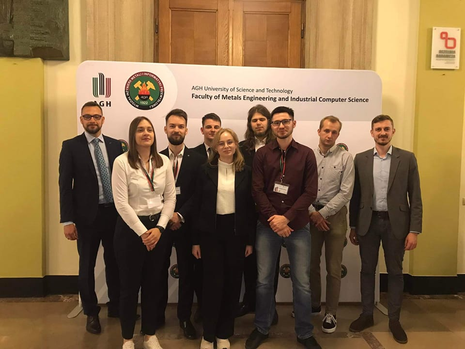

Sukces ma wiele imion... 
W naszym przypadku są to Natalia, Wiktoria i Nikodem 🤩
Na wczorajszej 59. Hutniczej Konferencji Studenckich Kół Naukowych AGH:
Natalia Ozdoba otrzymała wyróżnienie w Sekcji Inżynierii Metali 🏅
Wiktoria Skonieczna otrzymała wyróżnienie w Sekcji Przeróbki Plastycznej Metali 🏅
Nikodem Sroczyk zajął I miejsce w Sekcji Metalurgii, Odlewnictwa i Recyklingu 🥇

Serdecznie Wam gratulujemy 🎉🎉🎉

A na zdjęciu wraz z Koleżankami i Kolegami z AGH Hefajstos  pozujemy do zdjęcia przed uroczystym wręczeniem dyplomów dla laureatów 😎

#promat #agh #dzienhutnika #100latwimiip #jestemzWIMiIP