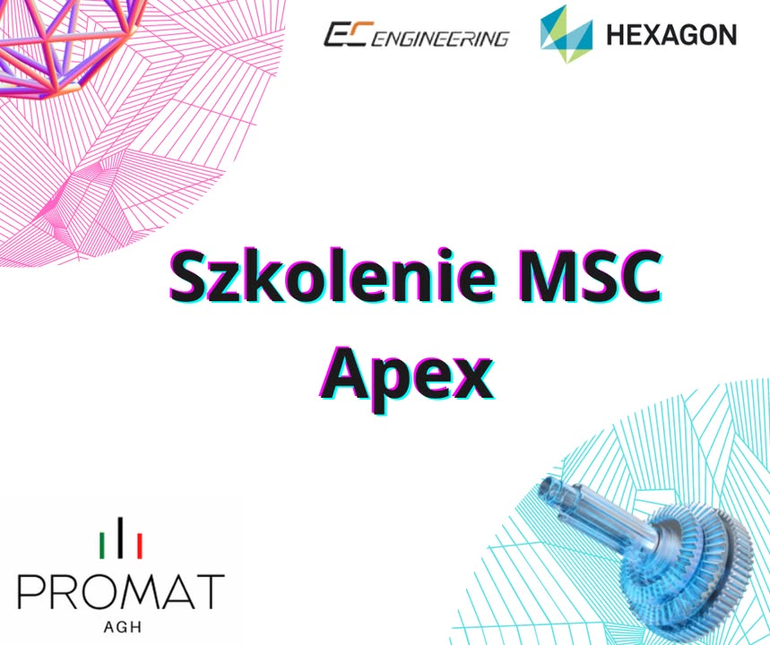

Pomimo przerwy wakacyjnej 🌞 nasi studenci nadal działają❗️ W ostatnich tygodniach członkowie naszego Koła👨‍💻, dzięki uprzejmości firmy EC Engineering Sp. z o.o. uczestniczyli w cyklu czterech szkoleń związanych z użytkowaniem oprogramowania MSC Apex💻.  
➡️Specjaliści z firmy Hexagon Manufacturing Intelligence przedstawili uczestnikom podstawy prawidłowej obsługi programu✅ oraz istotę optymalizacji modelów w projektowaniu 3D⚙️. Ważną częścią podjętego szkolenia 📈 była również możliwość wykonywania analiz inżynierskich zaprojektowanych modeli za pośrednictwem MSC Apex. Studenci 👨‍🎓 po podjętym szkoleniu na pewno poradzą sobie ze wszelkimi problemami, które czekają na nich w procesie modelowania w naszej sekcji druku 3D 😁.

#jestemzWIMiIP