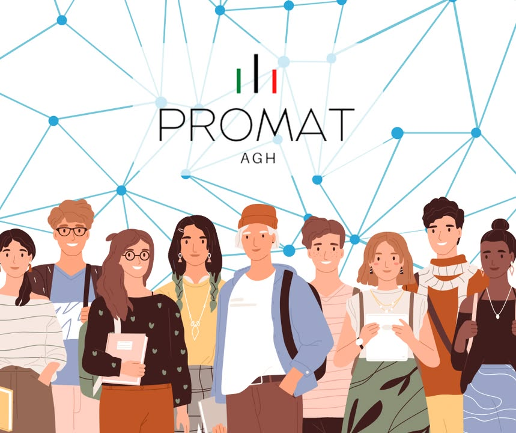

Powoli mija już połowa sierpnia i mamy nadzieję, że Wasze baterie zdążyły się trochę podładować 🔋😊. Jesteśmy bardzo szczęśliwi, że nawet w wakacje☀️ zyskujemy nowych obserwujących na naszym fanpage ‘u. Do tej pory udało nam się zgromadzić tu aż 187 osób👥, co daje nam tylko większą motywację do działania🤩. W związku z tym dla wszystkich, którzy są z nami od niedawna przedstawiamy garść informacji, abyście mogli nas lepiej poznać🙋‍♂️. Nasze Koło działa prężenie od 2000 roku w Katedrze Plastycznej Przeróbki Metali Wydziału Inżynierii Metali i Informatyki Przemysłowej ⚒🧑‍🔬. Jego pierwszym opiekunem był dr hab. inż. Tomasz Śleboda, prof. AGH, a następnie przez wiele lat funkcję tą pełnił dr hab. inż. Marek Wojtaszek, prof. AGH. ➡️Od tego czasu Promat zrzeszył wielu studentów🧑‍🎓🧑‍🎓, którzy otrzymali możliwość rozwijania swoich zainteresowań z zakresu inżynierii materiałowej🔬, a także komputerowych technik projektowania i modelowania💻. Nasi studenci również wielokrotnie uczestniczyli w programie akademickiej wymiany DAAD, dzięki czemu poszerzali swoją wiedzę oraz zgłębiali kulturę naszego zachodniego sąsiada 🇩🇪. Aktualnie KN Promat liczy 23 członków😱, którzy realizują swoje pasje angażując się w prowadzone przez nas projekty👩‍‍🏫, a nawet granty rektorskie. Możecie nas spotkać na przeróżnych wydarzeniach kulturalnych czy naukowych takich jak konferencje👨‍💼 lub dni otwarte‍🏢. Z czystym sumieniem możemy powiedzieć, że w Promacie nie ma nudy🥳, a dba o to nie kto inny jak nasz obecny opiekun dr. inż. Krystian Zyguła. Więcej informacji już wkrótce😎, do usłyszenia❗️

#jestemzWIMiIP