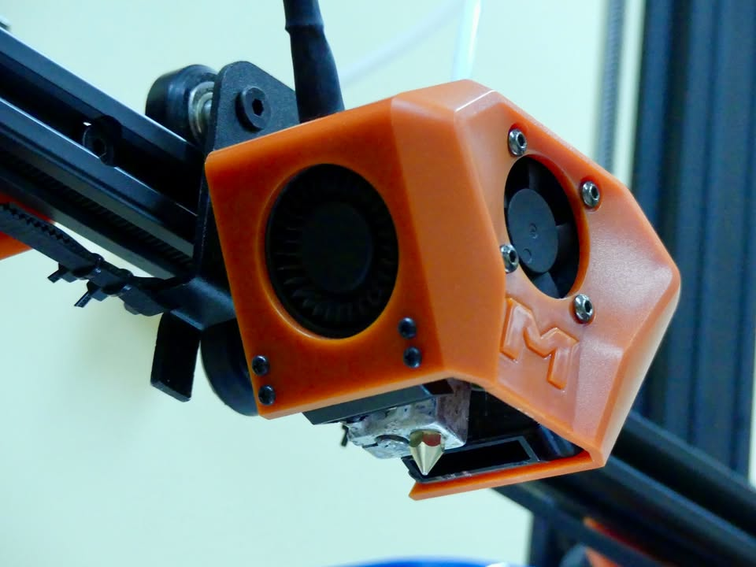

🔔 *Cześć wszystkim!* 🔔

Chcemy wam zaprezentować jeden z naszych tegorocznych projektów w ramach Grantu Rektora, który dotyczy budowy urządzenie na bazie drukarki 3D do inkrementalnego formowania blach! Celem projektu było zaprojektowanie urządzenia do kształtowania przyrostowego blach, bazującego na konstrukcji i podzespołach drukarki 3D. Kluczowe etapy, które zostały zrealizowane to modyfikacja drukarki, projektowanie narzędzi formujących oraz przygotowanie kompatybilnego G-code’u. 

Zbliżamy się do końca prac nad projektem, ale to dopiero początek! Już teraz zapraszamy was do dołączenia do naszego koła, aby wspólnie pracować nad kolejnymi, ekscytującymi projektami. Więcej szczegółów znajdziecie wkrótce na naszych profilach! 🌐

Nie przegapcie okazji — dołączcie do nas i budujcie przyszłość razem z nami! 🤝