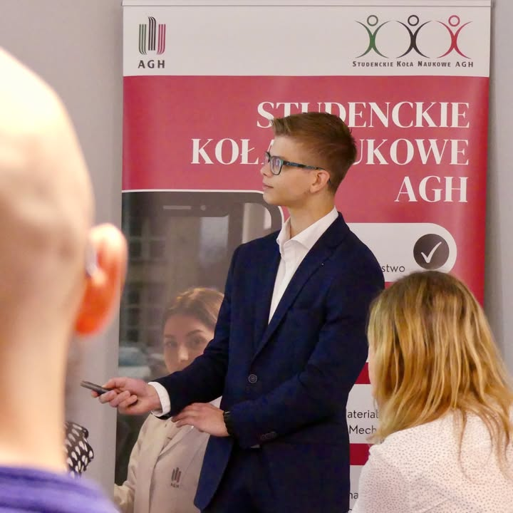

W miniony piątek, 18 października, w Studenckim Centrum Konstrukcyjnym odbyła się 28.Konferencja Studenckiego Ruchu Naukowego AGH podsumowująca granty rektora AGH w roku 2024. Nasze Koło Naukowe z sukcesem zakończyło i podsumowało dwa granty, nad którymi pracowaliśmy wytrwale przez ostatni rok. Pierwszy projekt zaprezentował nowo wybrany Przewodniczący naszego Koła, Jakub Sadrakuła, którego prezentacja koncentrowała się na konstrukcji do tłoczenia inkrementalnego, które dokładniej opisaliśmy w naszym ostatnim poście. Natomiast Bartłomiej Truczka podzielił się wynikami badań dotyczących atomizacji wiórów, które wykorzystano w druku 3D (post o tym projekcie pojawi się już niebawem). Obie prezentacje wzbudziły żywą dyskusję oraz aprobatę i zaciekawienie komisji.